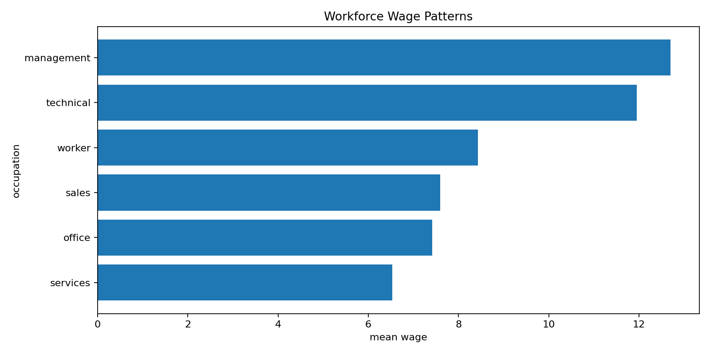

# Workforce Wage Patterns — executed results

## Decision question
How do hourly wages differ across occupation categories?

## Evidence
The largest observed mean wage is 12.704 for management. This ranking is descriptive, not a recommendation.

Raw rows: 534. Rows used: 534. Excluded for missing/nonfinite required values or invalid denominator: 0.

## Method
Complete-case descriptive comparison of wage by occupation; show group counts, mean, minimum and maximum.

## Interpretation and limitations
Historical survey; reported means are unweighted unless survey weights are supplied. No causal inference, significance claim or production deployment is implied. Missing values are not imputed; identical rows are retained. Small or repeated samples limit uncertainty interpretation.

## Recommended next decision
Review sample design and adjust for experience and education.

## Reproducibility
Source and exact downloaded-byte SHA256 are recorded in run_manifest.json. SQL results are in answer.csv and analysis.sqlite. Review quality_audit.csv before interpretation.
